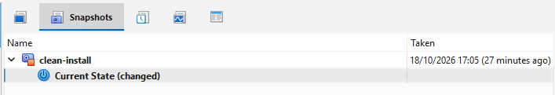
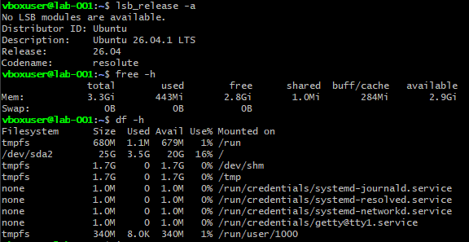
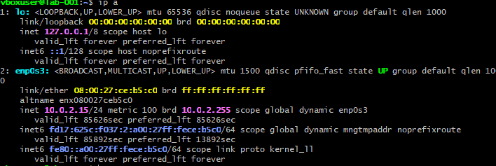

# Lab Setup: VirtualBox and Ubuntu Server VM

## Goal
Build a safe, disposable Linux lab I can break, harden and restore as the base for my security projects.

## Environment
- Host: Windows PC, 16 GB RAM
- Hypervisor: VirtualBox 7.2.20
- VM name: lab-001
- Guest OS: Ubuntu Server 26.04.1 LTS
- Resources: 2 vCPU, 4 GB RAM, 25 GB disk
- Network: NAT with a port-forwarding rule (host 127.0.0.1:2222 to guest port 22), so the VM is reachable from my PC only

## Steps
1. Checked that virtualization was enabled in Task Manager (Performance, CPU).
2. Downloaded the Ubuntu Server ISO and verified its SHA-256 checksum against the value published on releases.ubuntu.com.
3. Created the VM with "Skip Unattended Installation" ticked, so I could choose the install options myself.
4. Installed Ubuntu Server with the OpenSSH server option and a normal (non-root) user.
5. Added the port-forwarding rule and connected from Git Bash with `ssh -p 2222 user@127.0.0.1`.
6. Powered the VM off with `sudo poweroff` and took a snapshot named `clean-install`.

## Verification
After the first boot I checked the OS, memory, disk and network from inside the VM.

The VM runs Ubuntu 26.04.1 LTS with about 3.3 GB of usable RAM and a 25 GB disk (16% used).

The VM sits behind VirtualBox NAT with the address 10.0.2.15 on `enp0s3`, so it is not directly reachable from my home network.

## Problems and fixes
- **SSH connection refused, then hanging:** I mistyped the loopback address (first `127.9.0.1`, then `137.0.0.1`). The `ssh -v` output showed which address it was really connecting to, which is how I spotted it. The correct address is `127.0.0.1`.
- **Checking the port forwarding:** I confirmed the rule was set up correctly with `VBoxManage showvminfo lab-001`, which showed the NAT adapter and the rule for host port 2222 to guest port 22.

## What I learned
Snapshots let me experiment safely, because I can roll back to a working state. NAT with port forwarding keeps the VM reachable only from my own PC, which matters because I will later run deliberately vulnerable machines. I also learned to read `ssh -v` output to find out exactly where a connection fails.