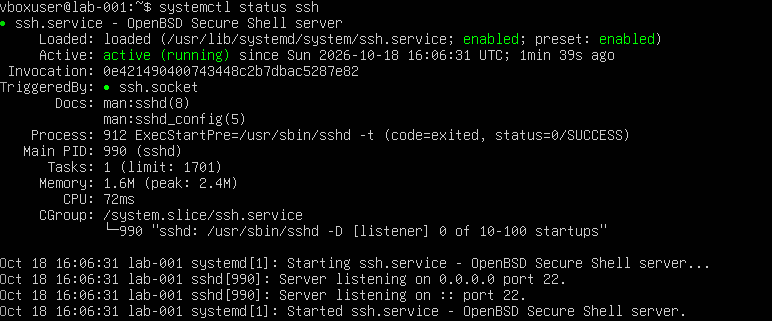
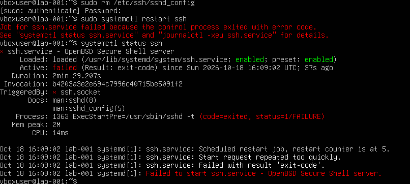
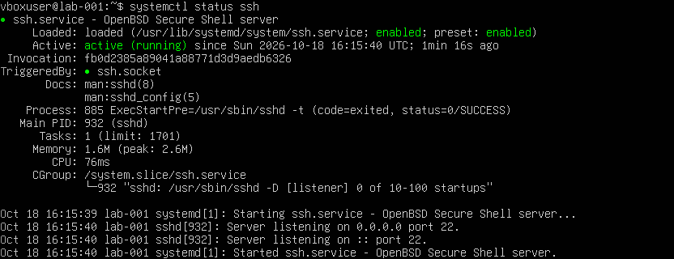
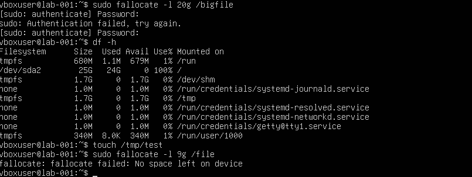

# Snapshot Practice: Break It, Restore It

## Goal
Learning how to break a system and recover it fast.

## Exercise 1: Deleted the SSH config
Before: the SSH service was healthy and listening on port 22.

- Ran: `sudo rm /etc/ssh/sshd_config` then `sudo systemctl restart ssh`
- Result: the restart failed and `systemctl status ssh` showed the service as `failed`.

- Why: before starting, systemd runs `sshd -t`, a built-in config test. With the config file gone, that check exited with status 1, so the service refused to start. systemd retried, then gave up with "Start request repeated too quickly". Nothing broke when the file was deleted, only on restart.
- Restore: powered off, restored the `clean-install` snapshot, started the VM and confirmed with `systemctl status ssh`.

## Exercise 2: Filled the disk
- Ran: `sudo fallocate -l 20g /bigfile`, then `df -h`
- Result: `/` showed 100% used with 0 available, and a second `sudo fallocate -l 9g /file` failed with "No space left on device".

- Why: a full disk stops services from writing logs and temp files. `touch /tmp/test` still worked, because `/tmp` is a tmpfs (it lives in memory, separate from the full disk), so only things that write to the real disk fail.
- Restore: restored `clean-install`.

## Lessons
- Config errors show up on restart, not when the file changes. Validate with `sshd -t` before restarting and keep a second session open.
- Monitor disk usage and rotate logs.
- Always snapshot before big changes.