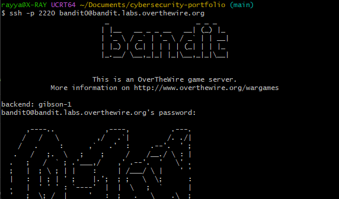
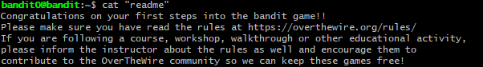
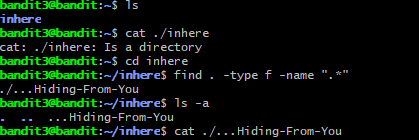

# Bandit Notes

Commands and what I learned from each level. No passwords.

## Level 0: Logging in

**The task:** Connect to the Bandit server over SSH.

**The fix:** `ssh -p 2220 bandit0@bandit.labs.overthewire.org`

**Why it worked:** SSH gives me a shell on a remote machine. The server uses port 2220 instead of the default 22, so I needed `-p`.

## Level 0 to 1: Reading a file

**The task:** Find the file in the home directory and read it.

**What I did:** `ls` to list what was there, then `cat "readme"` to print the file.

## Level 1 to 2: A file called `-`

**The task:** Read a file whose name is just a dash.

**What I tried first:** `cat -`. It sat there asking for input.

**The fix:** `cat ./-`

**Why it worked:** `cat` treats a lone `-` as "read from the keyboard". Adding `./` makes it a path to a file in this directory, so it reads the file.

## Level 2 to 3: Spaces and dashes in the name

**The task:** Read a file with spaces and dashes in its name.

**What I tried first:** Plain `cat` and `./` on its own. Both failed, and the errors show `cat` treating each word of the name as a separate file.

**The fix:** `./` plus the whole filename in quotes.

**Why it worked:** There were two problems at once. The spaces split the name into several arguments, so it needed quotes to stay as one. The leading dashes looked like an option, so it needed `./` in front.

## Level 3 to 4: Hidden file

**The task:** Find a hidden file inside a subdirectory.

**What I tried first:** `cat` on the directory, which gave "Is a directory". I used `cd` to go in, but `ls` showed nothing.

**The fix:** `ls -a` shows hidden files. I also used `find . -type f -name ".*"`, then `cat` on the file it found.

**Why it worked:** On Linux, files starting with a dot are hidden, so plain `ls` skips them. In the `find` command, `.` is the current directory, `-type f` means files only, and `-name ".*"` matches names that start with a dot.

## Quick reference

| Command | What it does | When I'd use it |
|---|---|---|
| `ssh -p PORT user@host` | Remote login on a specific port | Connecting to Bandit |
| `ls` | List files in a directory | First look at a new location |
| `ls -a` | List files including hidden ones | When a directory looks empty |
| `cat file` | Print a file's contents | Reading small text files |
| `cat ./name` | Force a name to be treated as a file path | Names like `-` or starting with dashes |
| `"quotes"` | Keep a name with spaces as one argument | Filenames with spaces |
| `cd` | Change directory | Moving into a subfolder |
| `find . -type f -name "pattern"` | Search for files by type and name | Locating files `ls` doesn't show |