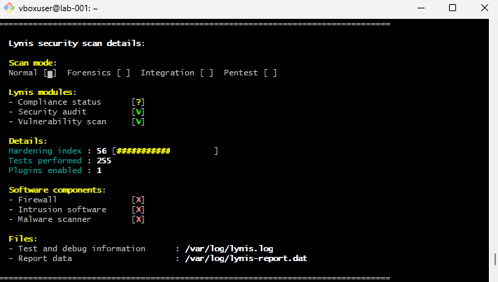
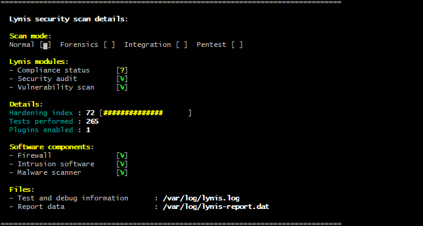
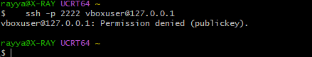
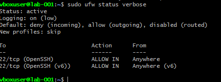
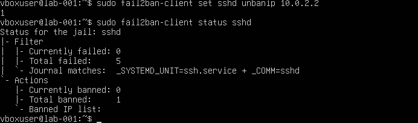
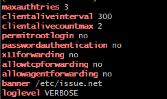
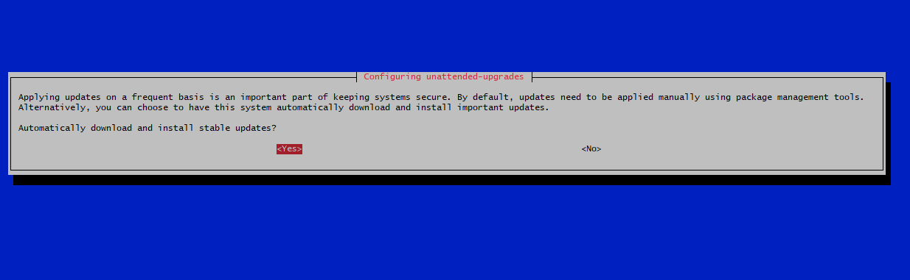

# Ubuntu Server Hardening Lab

Hardening an Ubuntu Server VM (VirtualBox, NAT networking) and measuring the result with Lynis. Each change is explained, tested and backed by evidence, including the mistakes along the way.

## Environment

| Item | Value |
|---|---|
| Host | Windows PC, Git Bash |
| Hypervisor | VirtualBox, NAT with port forward `127.0.0.1:2222` to VM port 22 |
| Guest OS | Ubuntu Server 26.04.1 LTS (VM `lab-001`) |
| Audit tool | Lynis 3.1.6 |

Before starting I took VM snapshots, so a lockout could be undone quickly.

## Results

| Stage | Lynis hardening index | Tests performed | Firewall / intrusion software / malware scanner |
|---|---|---|---|
| Baseline (fresh install) | 56 | 255 | not detected / not detected / not detected |
| After SSH, ufw and fail2ban | 66 | 265 | detected / detected / detected |
| After extra SSH settings, login banner, helper packages and automatic updates  | **72** | 265 | detected / detected / detected |

Baseline:



After hardening:



I aimed for a clear before and after with a reason for every change.

## What I changed

| # | Control | What it prevents |
|---|---|---|
| 1 | SSH key-only login, root login disabled | Password guessing and brute force |
| 2 | ufw firewall, default deny incoming | Unexpected services being reachable |
| 3 | fail2ban SSH jail | Repeated login attempts from one source |
| 4 | Extra SSH settings and login banner | Excess auth attempts, unneeded forwarding features |
| 5 | Further fixes from Lynis suggestions | Weak defaults, missing auditing and patching tools |

### 1. SSH key-only login
Created a separate ed25519 key for the VM (`~/.ssh/id_ed25519_lab`, with a passphrase) and installed the public key on the VM. Tested key login in a second window before changing any SSH setting.

Drop-in file `/etc/ssh/sshd_config.d/00-hardening.conf`:
```
PasswordAuthentication no
KbdInteractiveAuthentication no
PermitRootLogin no
X11Forwarding no
```
The `00-` prefix makes it load first, since the first value found for a setting gets applied. Validated with `sudo sshd -t` and confirmed the effective values with `sudo sshd -T`.

Test: a plain `ssh -p 2222 vboxuser@127.0.0.1` (no key offered) is refused with `Permission denied (publickey)`.



### 2. Firewall (ufw)
```
sudo ufw default deny incoming
sudo ufw default allow outgoing
sudo ufw allow OpenSSH
sudo ufw enable
sudo ufw status verbose
```
SSH was allowed before enabling the firewall, and access was confirmed from a second window.



### 3. fail2ban
Drop-in file `/etc/fail2ban/jail.d/sshd-local.conf`:
```
[sshd]
enabled = true
backend = systemd
mode = aggressive
maxretry = 3
findtime = 10m
bantime = 30m
ignoreip = 127.0.0.1/8 ::1 10.0.2.2
```

| Setting | Purpose |
|---|---|
| `backend = systemd` | Reads the journal, since SSH logs are not in a text file on this release |
| `mode = aggressive` | Catches more failure types, useful with password login off |
| `maxretry`, `findtime`, `bantime` | 3 failures within 10 minutes means a 30 minute ban |
| `ignoreip` | Lab-only whitelist of the NAT gateway (see Problems and fixes) |

Test: repeated failed logins as `baduser` triggered a ban, confirmed with `sudo fail2ban-client status sshd`.



### 4. Extra SSH settings and banner
File `/etc/ssh/sshd_config.d/60-lab-extra.conf`:
```
MaxAuthTries 3
LogLevel VERBOSE
X11Forwarding no
AllowAgentForwarding no
AllowTcpForwarding no
ClientAliveInterval 300
ClientAliveCountMax 2
Banner /etc/issue.net
```
Validated with `sudo sshd -t`, reloaded the service, and tested login from a new window before closing the old one. `sshd -T` confirmed every value took



### 5. Helper packages and automatic updates
```
sudo apt update
sudo apt install -y libpam-tmpdir apt-listchanges needrestart debsums unattended-upgrades auditd rkhunter
sudo dpkg-reconfigure -plow unattended-upgrades
```

| Package | Purpose |
|---|---|
| `unattended-upgrades` | Installs security updates automatically |
| `needrestart` | Flags services still using outdated libraries after an upgrade |
| `apt-listchanges` | Shows what changed in a package before it is upgraded |
| `debsums` | Verifies installed files against their package checksums |
| `auditd` | Records security-relevant system events |
| `rkhunter` | Scans for known rootkits |
| `libpam-tmpdir` | Gives each user a private temporary directory |

I chose **Yes** when asked whether to download and install stable updates automatically.



## Problems and fixes
- **Banned my own PC.** Because the VM is behind NAT, every connection from my PC appears as `10.0.2.2`. When I triggered a ban on purpose, all my SSH sessions froze, including open ones. I recovered from the VirtualBox console (which doesn't use SSH) with `sudo fail2ban-client set sshd unbanip 10.0.2.2`, then whitelisted that address with `ignoreip`. This is a lab-only fix, since on a real network the banned address would be the attacker's and I would not whitelist a gateway.
- **Typos in SSH config keywords.** A mistyped folder name and misspelled keywords (`X11 forwarding`, `ClientAliveInternal`) would have broken the config. `sshd -t` is the safety net, so I now validate before every reload.
- **Score didn't change at first.** `/var/log/lynis-report.dat` only updates when Lynis runs again, so I was reading the old report.

## What I learned
- Validate config changes with `sshd -t`, and keep a second session open when changing SSH.
- Keep a recovery path that doesn't depend on the thing being changed (here, the VM console).
- A hardening score is a guide. What matters is understanding what each control prevents.

## Next
- Further Lynis suggestions, with a final before and after comparison
- Network traffic analysis (Wireshark)