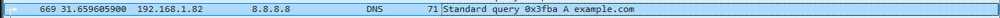
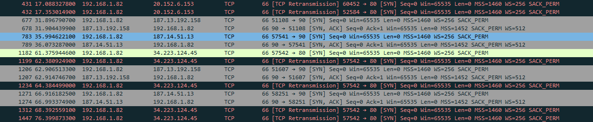
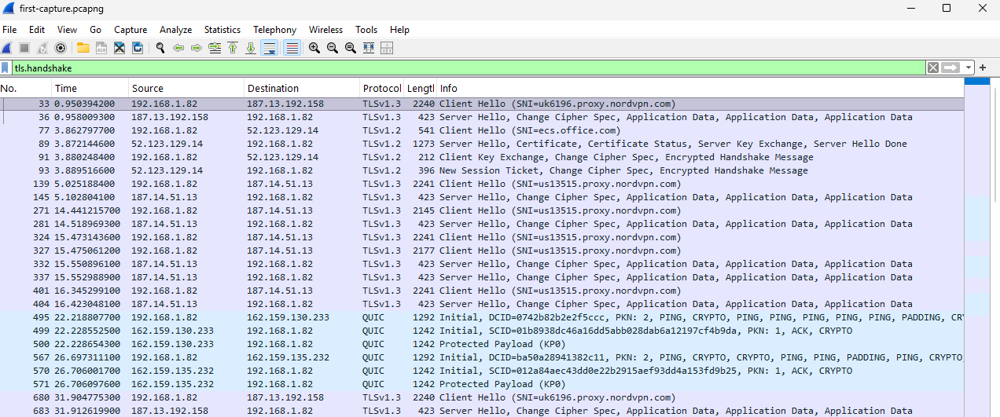

# Wireshark Basics: Reading My Own Traffic

## Goal
Learn what common protocols look like on the wire by capturing and reading my own traffic.

## Setup
- Wireshark on Windows, capturing on my Ethernet adapter on my home network.
- Generated traffic with a browser, `ping`, `nslookup example.com` and `curl http://neverssl.com`.
- A VPN proxy was running in the background during the capture, which turned out to be useful (see below).
- The capture file stays out of the repo, because captures can contain personal data.

## DNS
**Filter:** `dns`

My PC (`192.168.1.82`) sent a standard query for the A record of `example.com` to `8.8.8.8`, over UDP port 53. The transaction ID (`0x3fba`) matches the query to its answer.

**What I learned:** The domain name is sent in plain text, so anyone on the path (router, ISP, the DNS provider) can see which sites a device looks up, even when the site itself uses HTTPS. DNS logs are valuable to defenders, because malware has to look up its command server's domain.

## TCP handshake
**Filter:** `tcp.flags.syn == 1`

Every TCP connection starts with a three-way handshake: SYN, SYN-ACK, ACK. My filter shows only the first two steps. For example, frame 677 is my PC sending a SYN to port 90, and frame 678 is the SYN-ACK reply about 7.6 ms later. The SYN packets also carry the options being negotiated, such as maximum segment size, window scaling and selective acknowledgements.

Some SYNs got no answer. Frames 1182, 1199, 1234, 1312 and 1447 are the same connection attempt to port 80 on one address, retried about 1, 2, 4 and 8 seconds apart. Wireshark flags them as TCP retransmissions. That doubling is TCP backing off while waiting for a reply.

**What I learned:** A SYN with no SYN-ACK means the destination or something on the path isn't answering. Port scanners send many SYNs and judge a port by the reply: a SYN-ACK means open, a reset means closed, and silence usually means filtered. This is the pattern I'll look for when I scan my own lab VM.

## TLS handshake
**Filter:** `tls.handshake`

The Client Hello includes the **SNI** (server name indication), which names the site the client wants. Most of my HTTPS connections show a VPN proxy's hostname, not the real websites, because the traffic goes through the proxy. One connection shows `ecs.office.com`, a Microsoft service my PC contacted in the background.

Two TLS versions appear:
- The `ecs.office.com` connection used **TLS 1.2**, where the server's `Certificate` message is visible in the handshake.
- The proxy connections use **TLS 1.3**, where everything after the Server Hello is encrypted, including the certificate.

The `QUIC` rows are HTTP/3 over UDP. The TLS handshake is carried inside QUIC, which is why the `tls.handshake` filter shows them too.

**What I learned:** HTTPS hides the content, but not who you're talking to. The server name is visible in the Client Hello, so an observer sees which sites you use. With a VPN or proxy, they only see the proxy's name.

## Why this matters for security
- DNS, SNI and connection patterns are visible metadata, even when content is encrypted.
- Unencrypted protocols expose everything on the wire, so HTTPS matters.
- Unanswered SYNs and many short connections are the shape of scanning activity, which a defender can detect.

## Notes
- The VPN proxy was on during the capture. That's why most TLS connections point at the proxy, while my `nslookup` ran outside the browser and went straight to `8.8.8.8`.
- Captures can contain personal data, so I publish screenshots and never the `.pcapng` file. I checked each screenshot for MAC addresses and public IPs before posting.

## Next
- Scan my own lab VM with nmap and capture it, to see a port scan from the defender's side.
- Subnetting practice.